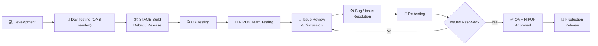

# NIPUN App Releases

Central release index for the **NIPUN Android Application** across DEV, STAGE, and PROD environments. 

> APK files are stored on Google Drive. This repository tracks the latest distributed builds and release notes.

### Play Store

[Download NIPUN App from Google Play Store](https://play.google.com/store/apps/details?id=com.nipun&hl=en_IN)

---

## Current Releases

### ESDS (Swaraj Cloud) Kubernetes

| Environment | Version | Build | Release Type | Build Date | Status | APK |
|---|---|---|---|---|---|---|
| 🟣 **ESDS DEV** | `2.0.0` | `10070` | Release | 19 Nov 2026 | 🧪 Development | [⬇️ Download](https://drive.google.com/file/d/1gq1G2kQi1Dm4OMeqyYHfrcKsiokhwWbH/view?usp=sharing) |
| 🟠 **ESDS STAGE** | `2.0.1` | `100073` | Release | 23 Nov 2026 | 🔍 Testing | [⬇️ Download](https://drive.google.com/file/d/11X2RRhIP9h9tdpWzgEc5226ilGbXIs6H/view?usp=drive_link) |
| 🟢 **ESDS PROD** | `2.0.0` | `100072` | Release | 20 Nov 2026 | 🔍 Production | [⬇️ Download](https://drive.google.com/file/d/10urc7YGU9jvudmSaNxRHm25SVGANJaDQ/view?usp=drive_link) |


### VOPA-AWS

| Environment | Version | Build | Release Type | Build Date | Status | APK |
|---|---|---|---|---|---|---|
| 🔵 **DEV** | `1.7.52` | `10069` | Debug | 22 Oct 2026 | 🧪 Development | [⬇️ Download](https://drive.google.com/file/d/1Hvg-bOoWCTnd2ivi5U4C-aBOB_bnFq1T/view?usp=sharing) |
| 🟠 **STAGE** | `1.7.53` | `10069` | Release | 02 Nov 2026 | 🔍 Testing | [⬇️ Download](https://drive.google.com/file/d/1CTGxSbmx4j7RWS-5TuNJ-Dj1EONxHLfG/view?usp=sharing) |
| 🟢 **PROD** | `1.7.53` | `10069` | Release | 02 Nov 2026 | ✅ Live | [⬇️ Download](https://drive.google.com/file/d/10JzS1_LpOxYpUWviU0n4OtGhaRAgjUDs/view?usp=sharing) |


## Release Flow



> **Release rule:** Any issues identified during STAGE testing go through **Review → Resolution → Re-testing** until QA and the NIPUN Team approve the build for production.

---

## Targeted Release

**Source:** 🟠 ESDS STAGE
**Target:** Oct 2nd Week  
**Status:** QA / NIPUN Team Testing

> The approved STAGE build will be promoted to PROD and submitted to the Play Store.

---

## Release Notes

**App Version:** 2.0.1
**Applies to:** 🟠 ESDS (Swaraj Cloud) Kubernetes STAGE

#### What Changed and How to Test

**1. Assessment capture: the levels fetch no longer blocks the UI**

- The levels fetch now runs in the background. A new levels gate screen appears if the levels are not ready.
- Test:
  - Open assessment capture for a student on a fast network, a slow network and offline.
  - Confirm the screen doesn't freeze.
  - Confirm the gate screen shows and clears correctly once the levels load.
  - Confirm assessment data is saved correctly.
  - Confirm the levels dropdown now shows descriptions.
  - Confirm the class list is in ascending order.

**2. NIPUN Tarang games: metrics now carry student context**

- The student context is now attached before WebView game events fire.
- Test:
  - Play sheet games as different students.
  - Confirm metrics and activity are recorded against the correct student.
  - Confirm nothing is lost or attributed to the wrong student when switching students.

**3. Student assessment timeline: year tabs fix**

- Stale student-list responses are now ignored when you switch year tabs.
- Test:
  - Switch year tabs quickly.
  - Confirm the list always matches the selected year.
  - Confirm there is no flicker or wrong data.

**4. UI and branding changes**

- Logo images were replaced (Headmaster, Inspector). Check them on all profile cards.
- The promotional screen has a new background, and the profile chooser has a new backdrop. Check these on different screen sizes.
- Minor UI change on the Assign Teachers screen.
- Translation updates in English and Marathi. Check for missing, truncated or wrong strings, especially on the About Us, Assign Teachers and profile screens.
- The parent profile gate and utils changed. Test the parent profile selection flow.

---

## Issue Reporting - Linear

Include the following when reporting an issue:

```text
Environment:
App Version:
Build Number:
Device:
Android Version:

Issue:
Steps to Reproduce:
Expected Behaviour:
Actual Behaviour:
Screenshot / Video:
```

---

## Developer's Note: Updating a Release

For every new build:

1. Upload APK to Google Drive.
2. Update the corresponding row in **Current Releases**.
3. Update **Current Release Notes** if required.
4. Update **Next Play Store Release** when the STAGE build becomes a release candidate.
5. Commit and push.

```bash
git add README.md
git commit -m "(version - date): ESDS/AWS DEV/STAGE/PROD release/debug update"
git push
```

---

**Maintained by:** VOPA Technology Team
