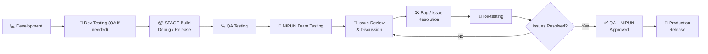

# NIPUN App Releases

Central release index for the **NIPUN Android Application** across DEV, STAGE, and PROD environments. 

> APK files are stored on Google Drive. This repository tracks the latest distributed builds and release notes.

### Play Store

[Download NIPUN App from Google Play Store](https://play.google.com/store/apps/details?id=com.nipun&hl=en_IN)

---

## Current Releases

### ESDS (Swaraj Cloud) Kubernetes

| Environment | Version | Build | Release Type | Build Date | Status | APK |
|---|---|---|---|---|---|---|
| 🟣 **ESDS DEV** | `2.0.0` | `10070` | Release | 19 Nov 2026 | 🧪 Development | [⬇️ Download](https://drive.google.com/file/d/1gq1G2kQi1Dm4OMeqyYHfrcKsiokhwWbH/view?usp=sharing) |
| 🟠 **ESDS STAGE** | `2.0.0` | `100070` | Release | 19 Nov 2026 | 🔍 Testing | [⬇️ Download](https://drive.google.com/file/d/1yDHg8Rk0A2iD_YWfZP82kIa8TQ09th7H/view?usp=drive_link) |
| 🟢 **ESDS PROD** | `2.0.0` | `100072` | Release | 20 Nov 2026 | 🔍 Production | [⬇️ Download](https://drive.google.com/file/d/10urc7YGU9jvudmSaNxRHm25SVGANJaDQ/view?usp=drive_link) |


### VOPA-AWS

| Environment | Version | Build | Release Type | Build Date | Status | APK |
|---|---|---|---|---|---|---|
| 🔵 **DEV** | `1.7.52` | `10069` | Debug | 22 Oct 2026 | 🧪 Development | [⬇️ Download](https://drive.google.com/file/d/1Hvg-bOoWCTnd2ivi5U4C-aBOB_bnFq1T/view?usp=sharing) |
| 🟠 **STAGE** | `1.7.53` | `10069` | Release | 02 Nov 2026 | 🔍 Testing | [⬇️ Download](https://drive.google.com/file/d/1CTGxSbmx4j7RWS-5TuNJ-Dj1EONxHLfG/view?usp=sharing) |
| 🟢 **PROD** | `1.7.53` | `10069` | Release | 02 Nov 2026 | ✅ Live | [⬇️ Download](https://drive.google.com/file/d/10JzS1_LpOxYpUWviU0n4OtGhaRAgjUDs/view?usp=sharing) |


## Release Flow



> **Release rule:** Any issues identified during STAGE testing go through **Review → Resolution → Re-testing** until QA and the NIPUN Team approve the build for production.

---

## Targeted Release

**Source:** 🟣 ESDS  
**Target:** Oct 2nd Week  
**Status:** QA / NIPUN Team Testing

> The approved STAGE build will be promoted to PROD and submitted to the Play Store.

---

## Release Notes

**App Version:** 2.0.0 and later fixes
**Applies to:** 🔵 VOPA-AWS and 🟣 ESDS (Swaraj Cloud) Kubernetes (same content)
**Source:** Commit log, 20 Nov 2026

> Screen names are taken from the commit log. The app was not run to write these notes, so confirm screen names while testing.

#### What Changed

- My school feature - added two sections search My school & Other school details
- Dashboard tiles UI improvements
- Fixed semi-English checkbox issue in AssignTeacher feature
- ORF UI improvements
- Student Timeline - Added separate tabs for last & current academic year
- Renamed tab My School as "तुमच्या शाळेची माहिती"
- UI improvements of 6U form upload
- **Home-learning icon.** The 1st, 4th and 7th student in the list get a Home icon next to the History icon on each subject. Tapping it shows a message that the student is using home learning features (English and Marathi).
- **Assessment audit notice.** For the same students, saving an assessment now shows a 5-second dialog with an animation. It says the record will be used for further audit (English and Marathi). Nothing in the list or on the assessment page shows which students are selected.
- **Class cards.** Each class card now has a light shadow and a blue stripe on the left edge, so the cards stand apart from each other.
- **AI Practice.** The mascot's help note now has a title: "What's the use of this feature?!" (English and Marathi).
- **Assign Teachers fix.** After a headmaster assigns a class to a teacher, the teacher details on the screen now refresh straight away. Before, the old details stayed until the screen was reopened.

1. **Pictures, audio and animations load differently.** The app's way of fetching media (images, audio, animations) was rebuilt. The old loaders were deleted. This touches almost every screen, so it carries the most risk.
2. **Server status check (revised).** The app now reads one status service instead of several separate health checks. It shows the maintenance screen only when the service reports maintenance, with the message and start time (IST) from the service. If only one service is down (for example Redis or Postgres), the app stays open and a pop-up appears when you use the affected feature. If the status can't be checked, the app stays open and shows a Retry message.
3. **Assessments.** Absent students show in red. Teachers can open an absent student's record. Offline schools now see the question on the teacher-selection screen. Completion is confirmed after the check finishes in the background. Multiple-choice labels were renamed to "पर्यायी प्रश्न" and "बहुपर्यायी प्रश्न". Escaped line breaks (`\n`) no longer show in question text.
4. **Blogs.** Fixed the last Marathi word being cut off on Android. Blog cards, list and pages use the new image loader.
5. **Smaller items.** Image compression was improved. The Games web page now works with the new test servers. The About Us links and the admin School Info page were fixed. The home banner no longer re-renders in a loop. The maintenance animation was fixed.

**1. Pictures, audio and animations everywhere**

- Open every main screen. Check that images appear and none stay blank or spin forever.
- Check each type: normal images, SVG images, animations and audio.
- Open an image full screen. It should open, and any error view should look right on a dark background.
- Turn the internet off, open a screen, then turn it back on. Failed images should recover on their own, or show one clear "retry" view that works.
- Leave the app open for 30+ minutes, then reopen screens. Images must still load (the login/media token refreshes in the background).
- Check these screens in particular: **Blogs (card, list, full page), Assign Teachers, Learning Material, audio assessments, AI practice screens, Subject Result, Student Evidence.**

**2. Blogs**

- Scroll the card feed, open "Know more", and open an inactive blog.
- Read Marathi text on **Android** and confirm the last word is not clipped.
- Check blog thumbnails, in-article images and animations.

**3. Maintenance and server-down screens**

- With the service reporting maintenance, the maintenance screen shows the configured message and the start time, for example "13 November 2026, 10:45 AM IST". The time doesn't change during the outage.
- When one service such as Redis or Postgres is down, the app stays open. Opening Login (Redis) or Student Timeline (Postgres) shows a pop-up with the service's message and start time.
- When the status service can't be reached, the app stays open and shows a Retry message once. It doesn't repeat on every screen.
- After recovery, the maintenance screen clears by itself within about 15 seconds. No reinstall is needed.
- The maintenance animation plays.

**4. Assessments (teacher and admin flows)**

- Absent students appear in **red**. Tapping an absent subject opens its record.
- Mark a student absent through the confirm-absent pop-up. Check the level dropdown.
- Offline school: the teacher-selection screen shows the question.
- Finish an assessment and confirm "completed" shows only after the background check ends. Test on slow internet.
- Question text has no stray `\n` characters.
- MCQ evidence chips read "पर्यायी प्रश्न" and "बहुपर्यायी प्रश्न".
- Audio assessment: record, play back and submit.
- The AI result screen still shows the assessment screen behind it.

**5. Other**

- **Games** open and load (including on test servers).
- **About Us** links open correctly.
- **Admin School Info** page works.
- **Home banner** loads, and also behaves when the banner list fails to load.
- **Photo uploads** still work after the compression change. Check clarity and upload time.

**6. New test items**

- **Home icon:** appears only on students 1, 4 and 7 of the list, comes before the History icon, and the message shows the first name in both languages.
- **Audit dialog:** appears only after the final save for those students, stays up for 5 seconds, then returns to the list with the result applied. Check that pressing back during the dialog doesn't lose the result.
- **Class cards:** the shadow and blue stripe look right on both Android and iOS.
- **Assign Teachers:** after assigning a class, the teacher details update without leaving the screen.
- **AI Practice:** the mascot note shows the title in both languages.

#### Test On

- Android (low-end and recent phones) and iOS if shipped.
- Fast Wi-Fi, slow 3G and offline-then-online.
- A fresh install and an upgrade from the previous version.
- Logins as teacher, admin and student, where roles apply.

#### Known Issues (not blocking)

- Some internal type-check warnings exist in the code. They don't affect how the app runs.
- 🟣 ESDS only: images might not load as CDN still needs to be set up on the ESDS infra.

---

## Issue Reporting - Linear

Include the following when reporting an issue:

```text
Environment:
App Version:
Build Number:
Device:
Android Version:

Issue:
Steps to Reproduce:
Expected Behaviour:
Actual Behaviour:
Screenshot / Video:
```

---

## Developer's Note: Updating a Release

For every new build:

1. Upload APK to Google Drive.
2. Update the corresponding row in **Current Releases**.
3. Update **Current Release Notes** if required.
4. Update **Next Play Store Release** when the STAGE build becomes a release candidate.
5. Commit and push.

```bash
git add README.md
git commit -m "(version - date): release/debug update"
git push
```

---

**Maintained by:** VOPA Technology Team
