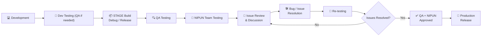

# NIPUN App Releases

Central release index for the **NIPUN Android Application** across DEV, STAGE, and PROD environments. 

> APK files are stored on Google Drive. This repository tracks the latest distributed builds and release notes.

### Play Store

[Download NIPUN App from Google Play Store](https://play.google.com/store/apps/details?id=com.nipun&hl=en_IN)

---

## Current Releases

### ESDS (Swaraj Cloud) Kubernetes

| Environment | Version | Build | Release Type | Build Date | Status | APK |
|---|---|---|---|---|---|---|
| 🟣 **ESDS DEV** | `1.7.54` | `10070` | Release | 04 Nov 2026 | 🧪 Development | [⬇️ Download](https://drive.google.com/file/d/1XN0hisKypKD1I50svrL7nfu67U6T5SAc/view?usp=sharing) |
| 🟠 **ESDS STAGE** | `1.7.55` | `10070` | Release | 09 Nov 2026 | 🔍 Testing | [⬇️ Download](https://drive.google.com/file/d/1Jrpi7nra3yAe6Q1qSV2q0p63TnxkhASt/view?usp=drive_link) |


### VOPA-AWS

| Environment | Version | Build | Release Type | Build Date | Status | APK |
|---|---|---|---|---|---|---|
| 🔵 **DEV** | `1.7.52` | `10069` | Debug | 22 Oct 2026 | 🧪 Development | [⬇️ Download](https://drive.google.com/file/d/1Hvg-bOoWCTnd2ivi5U4C-aBOB_bnFq1T/view?usp=sharing) |
| 🟠 **STAGE** | `1.7.53` | `10069` | Release | 02 Nov 2026 | 🔍 Testing | [⬇️ Download](https://drive.google.com/file/d/1CTGxSbmx4j7RWS-5TuNJ-Dj1EONxHLfG/view?usp=sharing) |
| 🟢 **PROD** | `1.7.53` | `10069` | Release | 02 Nov 2026 | ✅ Live | [⬇️ Download](https://drive.google.com/file/d/10JzS1_LpOxYpUWviU0n4OtGhaRAgjUDs/view?usp=sharing) |


## Release Flow



> **Release rule:** Any issues identified during STAGE testing go through **Review → Resolution → Re-testing** until QA and the NIPUN Team approve the build for production.

---

## Targeted Release

**Source:** 🟣 ESDS  
**Target:** Oct 2nd Week  
**Status:** QA / NIPUN Team Testing

> The approved STAGE build will be promoted to PROD and submitted to the Play Store.

---

## Release Notes

**App Version:** 1.7.54 and later fixes
**Applies to:** 🔵 VOPA-AWS and 🟣 ESDS (Swaraj Cloud) Kubernetes (same content)
**Source:** Commit log, 1 Nov – 9 Nov 2026

> Screen names are taken from the commit log. The app was not run to write these notes, so confirm screen names while testing.

#### What Changed

- My school feature - added two sections search My school & Other school details
- Dashboard tiles UI improvements
- Fixed semi-English checkbox issue in AssignTeacher feature
- ORF UI improvements
- Student Timeline - Added separate tabs for last & current academic year
- Renamed tab My School as "तुमच्या शाळेची माहिती"
- UI improvements of 6U form upload

1. **Pictures, audio and animations load differently.** The app's way of fetching media (images, audio, animations) was rebuilt. The old loaders were deleted. This touches almost every screen, so it carries the most risk.
2. **Server-down handling is new.** The app now checks server health and shows a maintenance screen or a warning pop-up when something is down.
3. **Assessments.** Absent students show in red. Teachers can open an absent student's record. Offline schools now see the question on the teacher-selection screen. Completion is confirmed after the check finishes in the background. Multiple-choice labels were renamed to "पर्यायी प्रश्न" and "बहुपर्यायी प्रश्न". Escaped line breaks (`\n`) no longer show in question text.
4. **Blogs.** Fixed the last Marathi word being cut off on Android. Blog cards, list and pages use the new image loader.
5. **Smaller items.** Image compression was improved. The Games web page now works with the new test servers. The About Us links and the admin School Info page were fixed. The home banner no longer re-renders in a loop. The maintenance animation was fixed.

**1. Pictures, audio and animations everywhere**

- Open every main screen. Check that images appear and none stay blank or spin forever.
- Check each type: normal images, SVG images, animations and audio.
- Open an image full screen. It should open, and any error view should look right on a dark background.
- Turn the internet off, open a screen, then turn it back on. Failed images should recover on their own, or show one clear "retry" view that works.
- Leave the app open for 30+ minutes, then reopen screens. Images must still load (the login/media token refreshes in the background).
- Check these screens in particular: **Blogs (card, list, full page), Assign Teachers, Learning Material, audio assessments, AI practice screens, Subject Result, Student Evidence.**

**2. Blogs**

- Scroll the card feed, open "Know more", and open an inactive blog.
- Read Marathi text on **Android** and confirm the last word is not clipped.
- Check blog thumbnails, in-article images and animations.

**3. Maintenance and server-down screens**

- With the live API down, the app should show the maintenance screen.
- With the database down, it should also show maintenance.
- With the main data store or cache down, it should show a global pop-up.
- Once the service is back, the app should return to normal without a reinstall.
- The maintenance animation should play.

**4. Assessments (teacher and admin flows)**

- Absent students appear in **red**. Tapping an absent subject opens its record.
- Mark a student absent through the confirm-absent pop-up. Check the level dropdown.
- Offline school: the teacher-selection screen shows the question.
- Finish an assessment and confirm "completed" shows only after the background check ends. Test on slow internet.
- Question text has no stray `\n` characters.
- MCQ evidence chips read "पर्यायी प्रश्न" and "बहुपर्यायी प्रश्न".
- Audio assessment: record, play back and submit.
- The AI result screen still shows the assessment screen behind it.

**5. Other**

- **Games** open and load (including on test servers).
- **About Us** links open correctly.
- **Admin School Info** page works.
- **Home banner** loads, and also behaves when the banner list fails to load.
- **Photo uploads** still work after the compression change. Check clarity and upload time.

#### Test On

- Android (low-end and recent phones) and iOS if shipped.
- Fast Wi-Fi, slow 3G and offline-then-online.
- A fresh install and an upgrade from the previous version.
- Logins as teacher, admin and student, where roles apply.

#### Known Issues (not blocking)

- Some internal type-check warnings exist in the code. They don't affect how the app runs.
- 🟣 ESDS only: images might not load as CDN still needs to be set up on the ESDS infra.

---

## Issue Reporting - Linear

Include the following when reporting an issue:

```text
Environment:
App Version:
Build Number:
Device:
Android Version:

Issue:
Steps to Reproduce:
Expected Behaviour:
Actual Behaviour:
Screenshot / Video:
```

---

## Developer's Note: Updating a Release

For every new build:

1. Upload APK to Google Drive.
2. Update the corresponding row in **Current Releases**.
3. Update **Current Release Notes** if required.
4. Update **Next Play Store Release** when the STAGE build becomes a release candidate.
5. Commit and push.

```bash
git add README.md
git commit -m "(version - date): release/debug update"
git push
```

---

**Maintained by:** VOPA Technology Team
